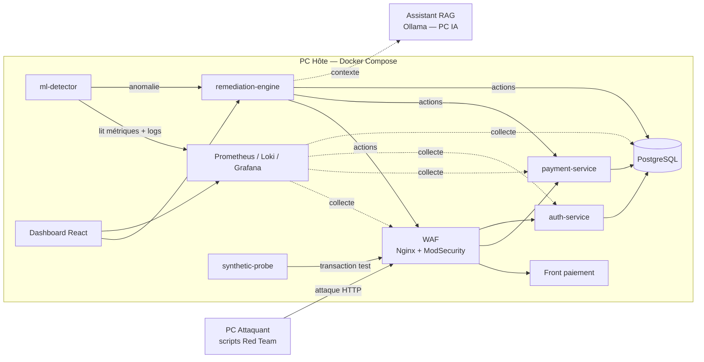

# PROJECT RESILIENCE-ALPHA — Workshop M2 2026

> « Tout système finit par tomber. La vraie question : le vôtre saura-t-il se relever seul ? »

Plateforme de paiement **fictive**, conteneurisée et **auto-résiliente** : elle subit une attaque réelle lancée depuis un PC Attaquant, la **détecte par machine learning**, se **remédie automatiquement** et prouve son rétablissement par **une nouvelle transaction réussie** — sans aucune intervention humaine.

## En une image



## Documentation

| # | Document | Contenu |
|---|----------|---------|
| 00 | [Cahier des charges](docs/00-cahier-des-charges.md) | Le sujet, les contraintes et la grille d'évaluation, reformulés |
| 01 | [Architecture globale](docs/01-architecture.md) | Topologie physique, composants, réseaux, flux principaux |
| 02 | [DEV — microservices](docs/02-dev-microservices.md) | Services, contrats d'API, modèle de données, dashboard |
| 03 | [INFRA](docs/03-infra.md) | Docker Compose, Ansible, observabilité, réseau du labo |
| 04 | [IA / DATA](docs/04-ia-data.md) | Détection d'anomalies ML, dataset, assistant RAG local |
| 05 | [CYBER](docs/05-cyber.md) | 🚧 Squelette à compléter : menaces, WAF, SIEM, durcissement, secrets |
| 06 | [Remédiation autonome](docs/06-remediation.md) | Moteur de remédiation, playbooks, garde-fous, preuve de reprise |
| 07 | [TRANSFORMATION — gouvernance](docs/07-gouvernance.md) | EBIOS RM, PCA/PRA, NIS2/DORA, recommandations à la direction |
| 08 | [Démo, chaos engineering & Clip Chrono](docs/08-demo-chaos.md) | Scénario de démo, tests de chaos, recette, script du clip |
| 09 | [Organisation & livrables](docs/09-organisation-livrables.md) | Planning, rôles, checklist de rendu, correspondance avec la grille |
| 10 | [**État d'implémentation & mode d'emploi**](docs/10-implementation.md) | Ce qui tourne réellement, résultats mesurés, écarts avec la cible |
| ADR | [Décisions d'architecture](docs/adr.md) | Choix techniques justifiés (pour l'axe « choix techniques justifiés ») |

## Structure du dépôt (cible)

```
workshop_2026/
├── README.md
├── docs/                     # cette documentation
├── scripts/init_secrets.py   # génération des secrets locaux
├── services/
│   ├── _shared/              # logs JSON, secrets, middleware communs
│   ├── front/                # front de paiement (React + Tailwind)
│   ├── dashboard/            # dashboard ops (React + Tailwind)
│   ├── auth-service/         # FastAPI — authentification JWT
│   ├── payment-service/      # FastAPI — comptes & transactions
│   ├── ml-detector/          # Python — détection d'anomalies
│   ├── remediation-engine/   # Python — décision + exécution des playbooks
│   ├── synthetic-probe/      # Python — transaction témoin périodique
│   ├── traffic-gen/          # Python — trafic légitime simulé
│   ├── pg-backup/            # sauvegardes vérifiées + restauration
│   └── rag-assistant/        # LangChain + Ollama
├── infra/
│   ├── docker-compose.yml
│   ├── postgres/             # schéma + rôles à moindre privilège
│   ├── waf/                  # config Nginx + ModSecurity + OWASP CRS
│   ├── observability/        # Prometheus, Loki, Alloy, Grafana, règles SIEM
│   └── ansible/              # déploiement, préparation de démo, arrêt
├── attack/                   # scripts du PC Attaquant
├── chaos/                    # scénarios d'injection de défaillances
├── ml/data/                  # étiquettes des campagnes (labels.csv)
├── secrets/                  # fichiers chiffrés SOPS uniquement (*.enc.yaml)
└── governance/               # EBIOS, PCA/PRA, NIS2/DORA (sources du dossier PDF)
```

## Démarrage rapide

```bash
python scripts/init_secrets.py
docker compose -f infra/docker-compose.yml up -d --build
```

- Front client : https://localhost/ (certificat auto-signé)
- Dashboard ops : http://127.0.0.1:8080 — Grafana : http://127.0.0.1:3000
- Le ML apprend la référence pendant ~10 min au premier démarrage (progression visible sur le dashboard).
- Tests de résilience : `python chaos/chaos.py list`

Détails, résultats mesurés et pièges : [docs/10-implementation.md](docs/10-implementation.md).

> ⚠ Le système de paiement est **entièrement codé par l'équipe** : aucune solution de paiement existante (pas de Stripe, pas de module tout fait).

## Livrables — dossier `Workshop2026-M2-G<n>`

- Dossier d'ingénierie et de gouvernance — PDF, 8 à 12 pages hors annexes
- Support de présentation — PPTX
- Clip Chrono — MP4, 60 s, **sans coupe**
- Archive code + déploiement — ZIP, README inclus, **aucun secret en clair**
- RESILIENCE-ALPHA fonctionnel en démo live

**Remise avant jeudi 23 h 59.**
