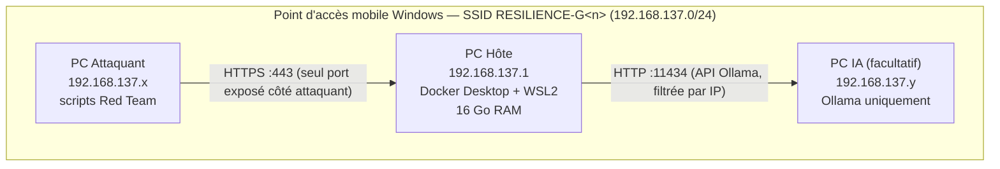
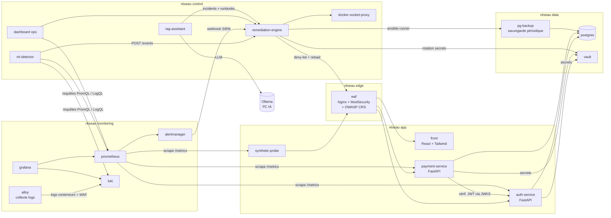
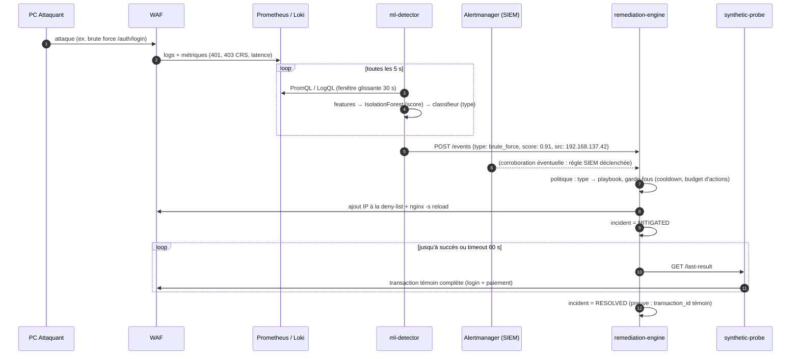
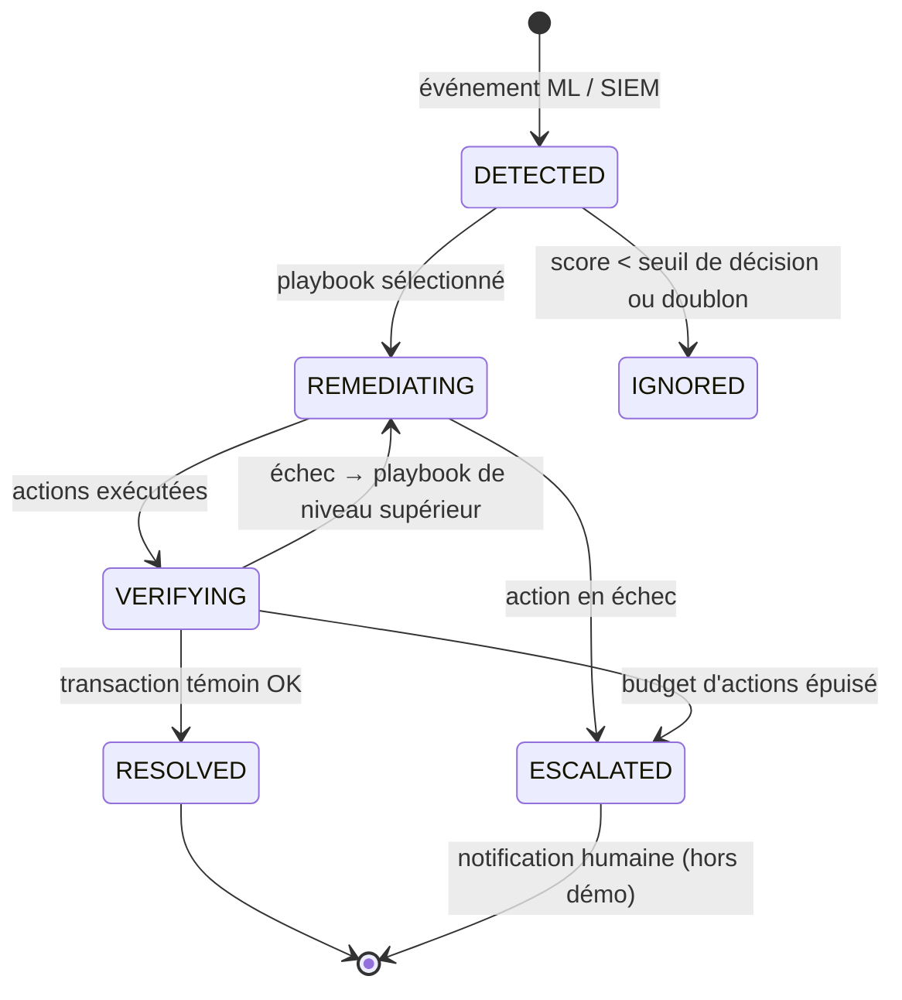

# 01 — Architecture globale

## 1. Principes directeurs

1. **Boucle fermée Observer → Détecter → Décider → Agir → Vérifier.** Chaque incident traverse cette boucle sans humain. La boucle ne se termine que quand la vérification (transaction témoin) réussit.
2. **Le chemin critique de remédiation est déterministe.** Le ML *détecte* et *qualifie* ; le moteur de remédiation *décide* selon des règles explicites et auditables. Le LLM (RAG) n'est **jamais** dans le chemin critique : il explique, il ne pilote pas.
3. **Moindre privilège partout**, et en particulier pour le moteur de remédiation, qui est le composant le plus puissant du système (axe 2 de la grille : « accès du moteur de remédiation maîtrisés »).
4. **Tout est code** : infrastructure (Compose + Ansible), règles WAF/SIEM, playbooks, dashboards Grafana. Un `deploy.yml` reconstruit tout.
5. **Segmentation réseau** : un service ne voit que ce dont il a besoin.

## 2. Topologie physique du labo



- Le PC Hôte porte le point d'accès : sous Windows, il prend l'adresse `192.168.137.1` (plage par défaut du partage de connexion).
- **Seul le port 443 (WAF)** est joignable depuis le PC Attaquant. Grafana, le dashboard ops et les API d'administration ne sont publiés que sur `127.0.0.1` ou filtrés par le pare-feu Windows.
- Le PC IA n'accepte des connexions sur `11434` que depuis le PC Hôte (règle de pare-feu).
- Sans PC IA, Ollama tourne sur le PC Hôte : il faut alors prévoir ~5-6 Go de RAM pour un modèle 8B quantifié en Q4 (voir le budget RAM, §6).

> ⚠ **À vérifier dès le jour 1 — l'IP source réelle.** Avec Docker Desktop (backend WSL2), les ports publiés passent par une couche NAT : le WAF peut voir **toutes** les requêtes venir de l'IP de la passerelle Docker au lieu de l'IP du PC Attaquant. La remédiation « bloquer l'IP attaquante » ne marcherait alors pas. Test : lancer `curl` depuis le PC Attaquant et lire `$remote_addr` dans les logs Nginx. Solutions de repli, dans l'ordre :
> 1. WSL2 en mode réseau `mirrored` (`.wslconfig` → `networkingMode=mirrored`) avec Docker Engine installé directement dans la distribution WSL ;
> 2. Remédiation par **empreinte** plutôt que par IP (jeton JWT / identifiant de compte, empreinte TLS JA3/JA4, User-Agent + motif) et rate-limit global ;
> 3. Reverse proxy natif Windows en frontal qui ajoute `X-Real-IP`.
>
> Le résultat de ce test est à consigner dans [adr.md](adr.md) (ADR-009).

## 3. Vue logique — composants



### Inventaire des conteneurs

| Conteneur | Pilier | Techno | Rôle | Exposé sur l'hôte |
|-----------|--------|--------|------|-------------------|
| `waf` | CYBER | Nginx + ModSecurity v3 + OWASP CRS | Reverse proxy TLS, filtrage applicatif, rate-limit, deny-list dynamique | **443** (tous) |
| `front` | DEV | React + Vite + Tailwind | Interface client : connexion, solde, virement | non (via WAF) |
| `auth-service` | DEV | Python FastAPI | Inscription, login, émission/révocation JWT, JWKS | non |
| `payment-service` | DEV | Python FastAPI | Comptes, transactions idempotentes, historique | non |
| `postgres` | DEV/INFRA | PostgreSQL 16 | Données métier + journal d'audit | non |
| `pg-backup` | INFRA | `pg_dump` + cron | Sauvegarde toutes les 2 min, rétention 1 h | non |
| `vault` | CYBER | HashiCorp Vault | Secrets dynamiques (identifiants BDD), clés de signature JWT | non |
| `prometheus` | INFRA | Prometheus | Métriques | 127.0.0.1:9090 |
| `alertmanager` | INFRA/CYBER | Alertmanager | Routage des alertes SIEM vers le moteur | non |
| `loki` | INFRA | Loki | Logs centralisés | non |
| `alloy` | INFRA | Grafana Alloy | Collecte des logs Docker → Loki | non |
| `grafana` | INFRA | Grafana | Visualisation, vue SIEM | 127.0.0.1:3000 |
| `ml-detector` | IA/DATA | Python, scikit-learn | Détection d'anomalies + qualification du type d'incident | non |
| `remediation-engine` | DEV | Python FastAPI + ansible-runner | Décision, exécution des playbooks, vérification | non |
| `docker-socket-proxy` | CYBER | tecnativa/docker-socket-proxy | Filtre l'accès au socket Docker (seules les routes autorisées) | non |
| `synthetic-probe` | DEV | Python | Transaction témoin toutes les 5 s, expose le taux de succès | non |
| `dashboard` | DEV | React + Tailwind | Vue ops : état du service, incidents, timeline | 127.0.0.1:8080 (ou `/ops` derrière WAF + auth) |
| `rag-assistant` | IA/DATA | LangChain + Chroma | Explication d'incidents, aide aux runbooks | non (via dashboard) |

## 4. Segmentation réseau Docker

| Réseau | Membres | Pourquoi |
|--------|---------|----------|
| `edge` | waf | Seul réseau relié à un port publié |
| `app` | waf, front, auth-service, payment-service, synthetic-probe | Trafic applicatif |
| `data` | auth-service, payment-service, postgres, pg-backup, vault, remediation-engine | Le WAF et le front n'atteignent **jamais** la BDD |
| `monitoring` | prometheus, loki, alloy, grafana, alertmanager, + tous les services exposant `/metrics` | Collecte |
| `control` | ml-detector, remediation-engine, docker-socket-proxy, dashboard, rag-assistant, prometheus, loki, alertmanager, waf | Plan de contrôle séparé du plan de données |

`docker-socket-proxy` n'est attaché **qu'au réseau `control`** et `internal: true` : seul le moteur de remédiation peut le joindre.

## 5. Flux principaux

### 5.1 Transaction de paiement nominale

```mermaid
sequenceDiagram
    autonumber
    actor U as Client (front)
    participant W as WAF
    participant A as auth-service
    participant P as payment-service
    participant D as PostgreSQL
    U->>W: POST /api/auth/login
    W->>A: (requête filtrée CRS)
    A->>D: vérif. hash argon2id
    A-->>U: access_token (JWT RS256, 10 min) + refresh_token
    U->>W: POST /api/payments  (Bearer JWT, Idempotency-Key)
    W->>P: (requête filtrée CRS + rate-limit)
    P->>P: vérif. signature JWT (JWKS en cache)
    P->>D: BEGIN; SELECT ... FOR UPDATE; débit/crédit; INSERT transaction; COMMIT
    P-->>U: 201 {transaction_id, status: "COMPLETED"}
```

### 5.2 Boucle d'auto-guérison (le cœur du projet)



Détail des playbooks : [06-remediation.md](06-remediation.md).

### 5.3 États d'un incident



## 6. Budget mémoire du PC Hôte (16 Go)

| Bloc | Estimation |
|------|-----------|
| Windows + Docker Desktop + WSL2 | ~4 Go |
| Services métier (front, auth, payment, probe) | ~0,6 Go |
| PostgreSQL + backup | ~0,4 Go |
| WAF | ~0,1 Go |
| Prometheus + Loki + Alloy + Grafana + cAdvisor + Alertmanager | ~1,5 Go |
| Vault | ~0,2 Go |
| ml-detector + remediation-engine + dashboard | ~0,6 Go |
| rag-assistant (sans le LLM) | ~0,5 Go |
| **Sous-total** | **~8 Go** |
| Ollama + modèle 8B Q4 *(si pas de PC IA)* | +5 à 6 Go |

→ Limiter la mémoire de WSL2 dans `%UserProfile%\.wslconfig` (`memory=10GB`) et poser des `mem_limit` sur chaque service dans le Compose. Le **PC IA est fortement recommandé** : il libère ~6 Go et évite que l'inférence LLM ne perturbe les métriques de latence que le ML surveille.

## 7. Correspondance architecture ↔ piliers (interconnexions)

La grille exige des piliers « réellement interconnectés ». Voici les liens concrets :

| De → Vers | Lien concret |
|-----------|--------------|
| CYBER → INFRA | Les logs WAF/ModSecurity partent dans Loki ; les règles SIEM sont des règles Prometheus/Loki |
| INFRA → IA | Le ml-detector consomme PromQL/LogQL ; l'entraînement utilise des exports Prometheus |
| IA → DEV | Le ml-detector appelle `POST /events` du moteur de remédiation |
| DEV → CYBER | Le moteur pousse la deny-list au WAF, révoque les JWT, fait tourner les secrets dans Vault |
| DEV → INFRA | Le moteur exécute des playbooks **Ansible** (restauration BDD, redéploiement) |
| TRANSFORMATION → tous | Chaque scénario EBIOS correspond à un playbook ; RTO/RPO du PCA/PRA = seuils mesurés par la sonde ; le journal d'audit sert la notification d'incident DORA |
| IA → TRANSFORMATION | Le RAG génère un brouillon de rapport d'incident au format de notification DORA |
