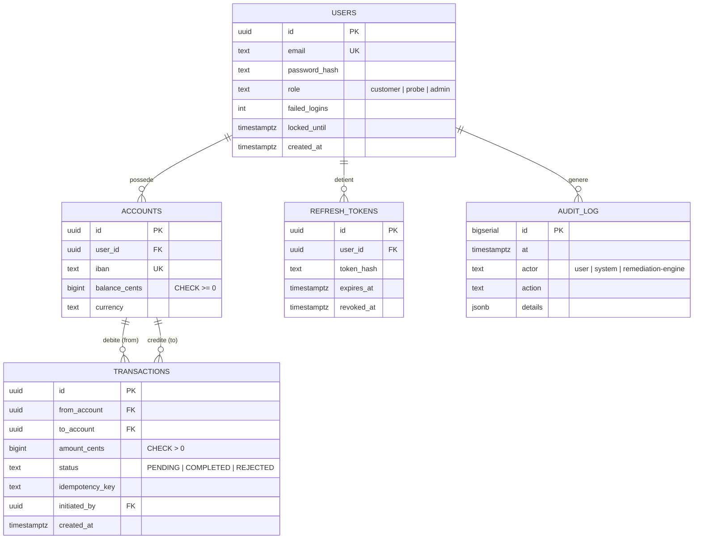

# 02 — DEV : microservices, API, données

## 1. Choix de stack

| Composant | Techno | Raison |
|-----------|--------|--------|
| auth-service, payment-service, remediation-engine, synthetic-probe | **Python 3.12 + FastAPI** | Un seul langage avec le pilier IA (scikit-learn, LangChain) → partage de code et de compétences ; OpenAPI générée automatiquement |
| ORM / accès BDD | SQLAlchemy 2 + `asyncpg`, migrations **Alembic** | Requêtes paramétrées (anti-injection SQL), schéma versionné |
| Métriques | `prometheus-fastapi-instrumentator` + compteurs métier | `/metrics` sur chaque service |
| Logs | JSON structuré sur stdout (`structlog`) | Collecte par Alloy, requêtable en LogQL |
| Front client + dashboard ops | **React 18 + Vite + Tailwind CSS** | Imposé par le sujet |
| Graphiques dashboard | Recharts | Léger, suffisant |
| Protocole | **REST/JSON** | Simple à observer dans le WAF et les logs (gRPC rendrait l'inspection WAF plus difficile) |

## 2. Services métier

### 2.1 auth-service

| Méthode | Route | Description |
|---------|-------|-------------|
| POST | `/auth/register` | Création de compte (email, mot de passe ≥ 12 caractères) |
| POST | `/auth/login` | Retourne `access_token` (JWT RS256, 10 min) + `refresh_token` (opaque, 24 h, stocké haché) |
| POST | `/auth/refresh` | Rotation du refresh token |
| POST | `/auth/logout` | Révocation du refresh token |
| POST | `/internal/revoke` | **Réservé au moteur de remédiation** (réseau `control` + jeton de service) : révoque toutes les sessions d'un compte ou incrémente l'époque globale des clés |
| GET | `/.well-known/jwks.json` | Clés publiques de vérification |
| GET | `/health`, `/metrics` | Sondes |

Points de sécurité :
- Hachage **argon2id** ; comparaison en temps constant.
- Verrouillage progressif par compte (backoff) **en plus** de la détection ML — défense en profondeur.
- Claims JWT : `sub`, `exp`, `iat`, `jti`, `kid`, `epoch`. Un incrément d'`epoch` (remédiation « compromission de clé ») invalide tous les jetons.
- Clé privée de signature lue depuis Vault au démarrage, jamais sur disque.

### 2.2 payment-service

| Méthode | Route | Description |
|---------|-------|-------------|
| GET | `/accounts/me` | Compte et solde de l'utilisateur authentifié |
| POST | `/payments` | Virement vers un autre compte. En-tête **`Idempotency-Key` obligatoire** |
| GET | `/payments/{id}` | Détail d'une transaction (uniquement si l'utilisateur en est partie prenante) |
| GET | `/payments?limit=20` | Historique |
| POST | `/internal/maintenance` | **Réservé au moteur** : bascule lecture seule (mode dégradé) |
| GET | `/health` | `200` seulement si la BDD répond (`SELECT 1`) |
| GET | `/metrics` | Dont `payments_total{status}`, `payment_amount_sum`, `db_pool_in_use` |

Corps de `POST /payments` :
```json
{ "to_account": "FR76-0000-0000-0042", "amount_cents": 1500, "currency": "EUR", "label": "Remboursement" }
```

Règles métier :
- Montants en **centimes entiers** (jamais de float).
- Transaction SQL unique : `SELECT ... FOR UPDATE` sur les deux comptes **dans un ordre déterministe** (id croissant) pour éviter les deadlocks.
- Refus si solde insuffisant, montant ≤ 0, plafond unitaire dépassé (ex. 5 000 €), compte destinataire inconnu.
- L'idempotence est garantie par une contrainte unique `(user_id, idempotency_key)` : un rejeu renvoie la même réponse.
- Contrôle d'accès objet (anti-IDOR) : toujours filtrer par `user_id` issu du JWT, jamais par un paramètre client.

### 2.3 front (client)

Écrans : Connexion · Tableau de bord (solde + dernières transactions) · Nouveau virement · Historique. Jeton d'accès en mémoire (pas de `localStorage`), refresh token en cookie `HttpOnly; Secure; SameSite=Strict`.

### 2.4 synthetic-probe

Le **juge de paix** de la remédiation. Toutes les 5 s :
1. login avec un compte de service `probe@resilience.local` ;
2. virement de 1 centime vers un compte puits, avec une `Idempotency-Key` unique ;
3. relecture de la transaction.

Expose :
- `probe_success` (gauge 0/1), `probe_duration_seconds` (histogramme), `probe_last_success_timestamp` ;
- `GET /last-result` → `{ "ok": true, "transaction_id": "...", "at": "...", "latency_ms": 84 }`.

La sonde passe **par le WAF**, comme un vrai client : si le WAF bloque à tort, la sonde le voit. Son IP est sur une **allow-list** du moteur de remédiation (on ne doit jamais la bannir).

## 3. Modèle de données



Le moteur de remédiation possède **sa propre base** (SQLite ou schéma `remediation` séparé avec un rôle PostgreSQL dédié) pour les incidents et actions — il ne doit pas dépendre de la BDD métier qu'il est censé réparer.

Rôles PostgreSQL (moindre privilège) :

| Rôle | Droits |
|------|--------|
| `auth_app` | RW sur `users`, `refresh_tokens` ; INSERT sur `audit_log` |
| `payment_app` | R sur `users` ; RW sur `accounts`, `transactions` ; INSERT sur `audit_log` |
| `backup` | `pg_read_all_data` |
| `postgres` (superuser) | utilisé uniquement par Ansible lors du déploiement / restauration |

Les identifiants applicatifs sont **dynamiques** (moteur `database` de Vault, TTL 1 h) — cf. [05-cyber.md](05-cyber.md).

## 4. Conventions communes

- Chaque service expose `/health` (liveness) et `/ready` (readiness : dépendances OK) → utilisés par les `healthcheck` Docker.
- En-tête `X-Request-ID` propagé du WAF jusqu'à la BDD (logs corrélables).
- Format de log :
  ```json
  {"ts":"2026-10-20T10:12:03Z","service":"payment-service","level":"info","request_id":"...","event":"payment.completed","user_id":"...","amount_cents":1500,"duration_ms":23}
  ```
- Jamais de secret, de mot de passe ou de jeton dans les logs.
- Erreurs au format RFC 9457 (`application/problem+json`), sans stack trace en production.
- Tests : `pytest` + `httpx` ; au minimum : parcours paiement, idempotence, solde insuffisant, IDOR, injection SQL refusée.

## 5. Dashboard ops (React + Tailwind)

Il est filmé dans le Clip Chrono : il doit être **lisible à distance** (grosses polices, couleurs franches, peu d'éléments).

```
┌───────────────────────────────────────────────────────────────────────┐
│  RESILIENCE-ALPHA        ● SERVICE OPÉRATIONNEL          10:12:03     │  ← bandeau vert / orange / rouge
├──────────────────┬──────────────────┬──────────────────┬──────────────┤
│ Transactions/min │ Taux de succès   │ Score anomalie ML│ Dernière     │
│      184         │     99,8 %       │   0,12  ▁▁▂▁     │ transaction  │
│                  │                  │                  │ témoin ✔ 2 s │
├──────────────────┴──────────────────┴──────────────────┴──────────────┤
│  Courbe : requêtes/s · erreurs/s · score ML  (5 dernières minutes)    │
├───────────────────────────────────────────────────────────────────────┤
│  TIMELINE INCIDENT                                                    │
│  10:10:41  ⚠ DÉTECTÉ      brute_force  score 0,91  src 192.168.137.42 │
│  10:10:42  ⚙ REMÉDIATION  block_ip → WAF deny-list                    │
│  10:10:47  ✔ VÉRIFIÉ      transaction témoin tx_8f3a… OK (84 ms)      │
│  10:10:47  ● RÉSOLU       RTO = 6 s                                   │
└───────────────────────────────────────────────────────────────────────┘
```

Sources de données :
- `GET /incidents` et `GET /incidents/stream` (SSE) du moteur de remédiation → timeline en temps réel ;
- API HTTP Prometheus (`/api/v1/query_range`) via un proxy en lecture seule → courbes ;
- bandeau d'état : vert = `probe_success == 1` et pas d'incident ouvert ; orange = incident en cours de remédiation ; rouge = sonde en échec.

Un onglet secondaire **« Assistant »** interroge le `rag-assistant` (« Que s'est-il passé à 10:10 ? »).
