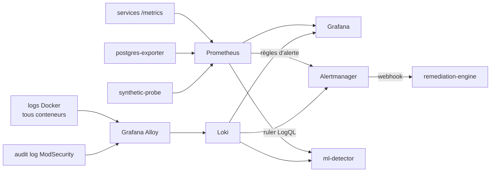

# 03 — INFRA : Docker Compose, Ansible, observabilité

## 1. Préparation des postes

### PC Hôte
- Windows 11, **Docker Desktop** avec le backend **WSL2**, 16 Go RAM minimum.
- `%UserProfile%\.wslconfig` :
  ```ini
  [wsl2]
  memory=10GB
  processors=6
  ```
- Dans la distribution WSL (Ubuntu) : `ansible`, `sops`, `age`, `python3-docker`.
- Point d'accès mobile Windows activé : SSID `RESILIENCE-G<n>`, mot de passe fort (et pas dans le dépôt).
- Pare-feu Windows : entrée autorisée sur **TCP 443** depuis `192.168.137.0/24` ; tout le reste refusé.
- Mise en veille et mises à jour Windows **désactivées** pendant la semaine (une mise à jour forcée pendant la démo = démo perdue).

### PC Attaquant
- N'importe quel OS ; idéalement Kali ou une VM Linux. Outils : `python3` + `requests`/`httpx`, `hydra`, `sqlmap`, `ffuf`, `hey` ou `vegeta`.
- Les scripts d'attaque sont dans `attack/` et versionnés (reproductibilité de la démo).

### PC IA (facultatif)
- Ollama installé nativement, écoute sur `0.0.0.0:11434`, pare-feu limité à `192.168.137.1`.
- Modèles pré-téléchargés **avant** le jour de la démo (pas de dépendance à Internet).

## 2. Docker Compose

Fichier unique `infra/docker-compose.yml`, plus des profils :

| Profil | Services | Usage |
|--------|----------|-------|
| *(défaut)* | plateforme complète sans LLM | démo avec PC IA |
| `llm-local` | + `ollama` | pas de PC IA |
| `chaos` | + `pumba` / `toxiproxy` | tests d'injection de défaillances |

Conventions imposées à **chaque** service :

```yaml
  payment-service:
    image: resilience/payment-service:${TAG:-dev}
    build: ../services/payment-service
    restart: unless-stopped            # 1er niveau d'auto-guérison : crash → redémarrage
    read_only: true                    # FS racine en lecture seule
    tmpfs: [/tmp]
    user: "10001:10001"                # jamais root
    cap_drop: [ALL]
    security_opt: ["no-new-privileges:true"]
    mem_limit: 256m
    cpus: 0.5
    pids_limit: 200
    environment:
      VAULT_ADDR: http://vault:8200
    secrets: [payment_vault_role_id, payment_vault_secret_id]
    healthcheck:
      test: ["CMD", "python", "-c", "import urllib.request;urllib.request.urlopen('http://localhost:8000/ready')"]
      interval: 5s
      timeout: 2s
      retries: 3
      start_period: 10s
    depends_on:
      postgres: { condition: service_healthy }
      vault:    { condition: service_healthy }
    networks: [app, data, monitoring]
    labels:
      resilience.remediable: "true"    # le moteur ne peut agir QUE sur les conteneurs étiquetés
      resilience.tier: "business"
```

Remarque : `restart: unless-stopped` gère les crashs de processus. Il **ne gère pas** un conteneur vivant mais `unhealthy` (Docker Compose ne redémarre pas sur healthcheck KO). C'est le moteur de remédiation qui comble ce manque (playbook `restart_unhealthy`).

Réseaux :

```yaml
networks:
  edge:       {}
  app:        { internal: true }
  data:       { internal: true }
  monitoring: { internal: true }
  control:    { internal: true }
```

`internal: true` → aucun accès sortant vers Internet depuis ces réseaux.

## 3. Ansible

Inventaire `infra/ansible/inventory.ini` :

```ini
[host]
localhost ansible_connection=local

[llm]
pc-ia ansible_host=192.168.137.y ansible_user=resilience
```

| Playbook | Rôle | Déclencheur |
|----------|------|-------------|
| `deploy.yml` | Déchiffre les secrets SOPS → initialise/descelle Vault → `docker compose up -d` → migrations Alembic → données de démo → vérification de santé | Humain (avant la démo) |
| `teardown.yml` | Arrêt propre, purge des volumes (option `-e purge=true`) | Humain |
| `remediation/restore_db.yml` | Arrêt des services métier → restauration du dernier dump sain → redémarrage → vérif. | **Moteur de remédiation** |
| `remediation/redeploy_service.yml` | Recrée un conteneur depuis l'image de référence (ex. après altération du FS) | **Moteur de remédiation** |
| `remediation/rotate_secrets.yml` | Révoque les baux Vault, regénère la clé JWT, redémarre auth/payment | **Moteur de remédiation** |
| `harden.yml` | Vérifie les options de sécurité du Compose, scanne les images (Trivy) | CI / humain |
| `llm.yml` | Installe et configure Ollama sur le PC IA, télécharge le modèle | Humain |

Le moteur de remédiation lance les playbooks via **`ansible-runner`** (API Python), avec un inventaire et un répertoire de playbooks **montés en lecture seule** : il ne peut exécuter que ce qui a été écrit et relu à l'avance.

## 4. Observabilité



> Promtail est en fin de vie : on utilise **Grafana Alloy** pour la collecte des logs.

### Métriques clés

| Métrique | Source | Utilisée par |
|----------|--------|--------------|
| `nginx_http_requests_total{status}` / logs d'accès WAF | WAF | ML, SIEM |
| `modsec_blocked_total{rule_id}` (dérivée des logs) | WAF | ML, SIEM |
| `http_request_duration_seconds` | services FastAPI | ML |
| `auth_login_total{result="success|failure"}` | auth-service | ML, SIEM |
| `payments_total{status}` | payment-service | ML, dashboard |
| CPU / mémoire des conteneurs métier | API Docker (`/containers/<id>/stats`) via le proxy en lecture seule — cAdvisor ne fonctionne pas avec le stockage containerd de Docker Desktop | ML |
| `pg_stat_database_*`, `pg_up` | postgres-exporter | ML, SIEM |
| `probe_success`, `probe_duration_seconds` | synthetic-probe | **Vérification de remédiation**, dashboard |
| `remediation_actions_total{playbook,result}`, `incident_rto_seconds` | remediation-engine | dashboard, dossier |

Rétention Prometheus : 48 h (suffisant, économise la RAM). Intervalle de collecte : **5 s** (pour détecter en moins de 20 s).

### Dashboards Grafana (provisionnés en code)

1. **Vue service** — RPS, latence p95, erreurs, `probe_success`.
2. **Vue SIEM** — événements de sécurité : blocages WAF par règle, échecs de login par IP, alertes déclenchées.
3. **Vue ML** — score d'anomalie, contribution des features, décisions.
4. **Vue remédiation** — actions exécutées, durée, RTO par incident.

## 5. Sauvegardes (support du PRA)

- `pg-backup` : `pg_dump -Fc` **toutes les 2 min**, rétention 1 h, sur un volume dédié `backups`, monté en écriture par `pg-backup` seulement. Les services métier ne le montent pas : une application compromise ne peut pas effacer les sauvegardes.
- Chaque dump est **vérifié** (`pg_restore --list`) et horodaté ; un fichier `latest_good` pointe vers le dernier dump valide.
- Un dump n'est marqué « sain » que si `probe_success == 1` au moment du dump (on ne sauvegarde pas un état corrompu par l'attaque comme référence).
- Option bonus : archivage WAL continu pour un RPO proche de zéro.
