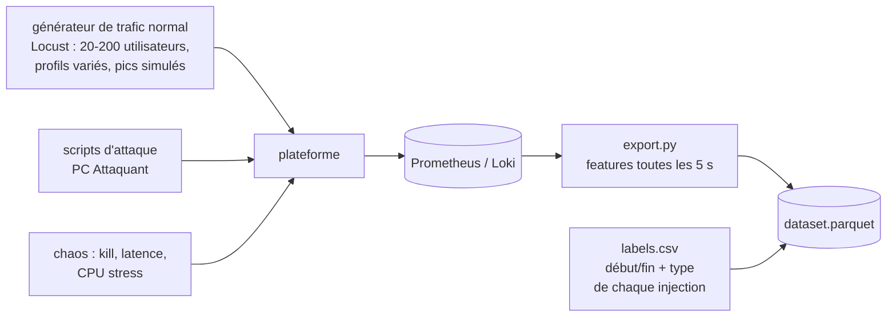
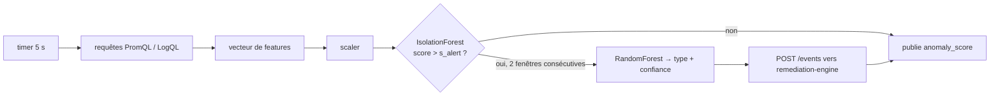
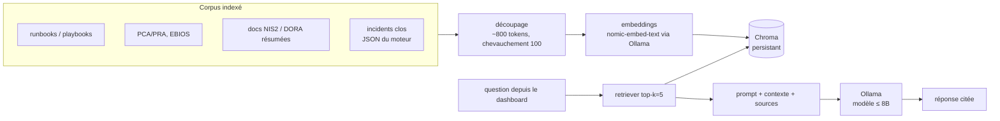

# 04 — IA / DATA : détection ML et assistant RAG

## 1. Pourquoi du ML et pas des seuils

Le sujet interdit la détection « par de simples seuils fixes ». Un seuil du type « plus de 50 erreurs 401 par minute » est fragile : il dépend de la charge, il ne voit pas les attaques lentes et il ne combine pas les signaux. Notre détecteur apprend le **comportement normal multivarié** de la plateforme (trafic, erreurs, latence, ressources, sécurité), puis signale les écarts.

Il y a deux étages :

| Étage | Modèle | Question | Pourquoi ce modèle |
|-------|--------|----------|--------------------|
| 1. Détection | **Isolation Forest** (non supervisé) | « Ce comportement est-il anormal ? » | S'entraîne sur du trafic normal seul, rapide, robuste aux features hétérogènes, peu de RAM |
| 2. Qualification | **Random Forest** (supervisé) | « De quel type d'incident s'agit-il ? » | Choisit le bon playbook ; interprétable (importance des features) |

L'étage 1 seul pourrait déclencher un playbook générique. L'étage 2 rend la remédiation **ciblée** : on ne bannit pas une IP pour une panne de base de données.

> Alternative possible pour l'étage 1 : un auto-encodeur (PyTorch) sur les fenêtres de séries temporelles. Plus élégant, mais plus long à mettre au point. À garder en option si l'Isolation Forest donne trop de faux positifs.

## 2. Features

Le détecteur calcule toutes les **5 s** un vecteur sur une **fenêtre glissante de 30 s** :

| # | Feature | Source | Signal pour |
|---|---------|--------|-------------|
| 1 | requêtes/s au WAF | Prometheus | flood / DoS |
| 2 | ratio de réponses 4xx | Prometheus | scan, brute force |
| 3 | ratio de réponses 5xx | Prometheus | panne, crash |
| 4 | ratio d'échecs de login | auth-service | brute force / credential stuffing |
| 5 | nb d'IP sources distinctes | Loki (logs WAF) | attaque distribuée |
| 6 | part du trafic de l'IP la plus active | Loki | attaque mono-source |
| 7 | blocages ModSecurity/s | Loki | injection, XSS |
| 8 | score d'anomalie CRS moyen | Loki | injection |
| 9 | latence p95 de l'API | Prometheus | saturation |
| 10 | CPU des conteneurs métier | cAdvisor | DoS, cryptominage |
| 11 | mémoire des conteneurs métier | cAdvisor | fuite, DoS |
| 12 | connexions PostgreSQL actives | postgres-exporter | épuisement du pool |
| 13 | `DELETE`/`UPDATE` massifs (tuples modifiés/s) | postgres-exporter | altération de données |
| 14 | taux d'échec de la sonde | synthetic-probe | impact métier réel |
| 15 | nb de conteneurs `unhealthy` / redémarrés | cAdvisor / Docker | panne d'infrastructure |
| 16 | entropie des chemins demandés | Loki | fuzzing / énumération |

Normalisation : `RobustScaler` (médiane/IQR), entraîné sur la période normale.

## 3. Jeu de données



1. **Normal** : ≥ 2 h de trafic Locust avec des variations réalistes (heures creuses, pics, montées de charge). C'est le seul jeu dont l'étage 1 a besoin.
2. **Attaques et pannes** : chaque scénario de [05-cyber.md](05-cyber.md) et de [08-demo-chaos.md](08-demo-chaos.md) est rejoué **10 à 20 fois** avec des intensités différentes. Un script horodate début et fin → labels automatiques.
3. Classes de l'étage 2 : `normal`, `brute_force`, `injection`, `http_flood`, `data_tampering`, `service_crash`, `db_outage`, `resource_exhaustion`.
4. Découpage **temporel** train/test (pas aléatoire : des fenêtres voisines sont corrélées, un découpage aléatoire gonflerait artificiellement les scores).

## 4. Entraînement et évaluation

- Notebook `ml/train.ipynb` → artefacts `ml/models/{scaler,iforest,classifier}.joblib` + `model_card.md`.
- `contamination` de l'Isolation Forest réglée pour **0 faux positif sur 30 min de trafic normal de test**.
- Métriques présentées dans le dossier :
  - étage 1 : précision, rappel, **délai moyen de détection** (secondes entre le début de l'injection et la 1re alerte) ;
  - étage 2 : matrice de confusion, F1 macro ;
  - courbe du score dans le temps pendant une attaque (figure du dossier).

## 5. Service `ml-detector` en production



- **Anti-rebond** : il faut 2 fenêtres anormales consécutives (≈ 10 s) avant d'émettre ; une fois l'événement émis, pas de nouvel événement du même type pendant 30 s.
- Événement envoyé :
  ```json
  {
    "source": "ml-detector",
    "type": "brute_force",
    "anomaly_score": 0.91,
    "confidence": 0.87,
    "window": {"start": "2026-10-20T10:10:11Z", "end": "2026-10-20T10:10:41Z"},
    "top_features": [["login_failure_ratio", 0.62], ["top_ip_share", 0.21]],
    "suspects": {"src_ip": "192.168.137.42", "user_agent": "python-httpx/0.27"},
    "model_version": "2026-10-21-a"
  }
  ```
- `suspects` est extrait des logs Loki de la fenêtre (IP la plus présente parmi les requêtes en échec) : c'est ce qui permet une remédiation ciblée.
- Métriques exposées : `ml_anomaly_score`, `ml_events_total{type}`, `ml_inference_seconds`.
- **Dégradé** : si le ml-detector tombe, Docker le redémarre et les règles SIEM d'Alertmanager restent un filet de sécurité. On le dit à l'oral, mais **la démo doit montrer le ML** qui déclenche.

## 6. Assistant RAG local

### Rôle
Aider l'humain **après coup** ou en lecture : « Pourquoi le service est-il tombé à 10:10 ? », « Quel est le RTO cible du PRA pour la BDD ? », « Rédige le brouillon de notification d'incident ». Il **ne déclenche aucune action**.

### Architecture



| Élément | Choix | Remarque |
|---------|-------|----------|
| LLM | `llama3.1:8b` ou `qwen2.5:7b` (Q4_K_M) | Respecte la limite de **8 milliards de paramètres** ; tester les deux en français |
| Embeddings | `nomic-embed-text` (Ollama) | Local, léger |
| Vector store | Chroma (fichier local) | Zéro service supplémentaire |
| Orchestration | LangChain (`langchain-ollama`, `langchain-chroma`) | Imposé |
| API | FastAPI `POST /ask {question}` → `{answer, sources[]}` | Consommée par le dashboard |

Garde-fous :
- Prompt système : répondre **uniquement** à partir du contexte, citer les sources, dire « je ne sais pas » sinon.
- Les incidents indexés sont **assainis** (pas de jetons, pas de mots de passe) avant indexation.
- Le contenu des logs est traité comme **donnée non fiable** : un attaquant peut injecter du texte dans un User-Agent pour tenter une *prompt injection*. C'est une raison de plus pour que le RAG n'ait aucun pouvoir d'action.
- Petit jeu d'évaluation (10-15 questions/réponses attendues) pour comparer les modèles et le découpage.

## 7. Implémentation actuelle (écart avec la conception)

Voir aussi [10-implementation.md](10-implementation.md).

**Étage 1 : ensemble de deux modèles appris sur la référence.** La campagne de chaos du 19/10 a montré une limite de l'Isolation Forest seul : il **ne peut pas découper une feature constante pendant l'apprentissage**. Or les signaux les plus fiables sont justement constants en régime normal : sonde en échec, cible arrêtée, base injoignable, invariant comptable. Une altération massive des soldes faisait à peine monter le score (0,53-0,62) et était qualifiée à tort de `service_crash`.

| Modèle | Couvre | Apprentissage |
|--------|--------|---------------|
| IsolationForest + RobustScaler | combinaisons inhabituelles de trafic, latence, ressources | 120 fenêtres saines ; seuil = pire score observé + 3 % |
| Enveloppe robuste | `probe_failure`, `targets_down`, `pg_down`, `ledger_drift`, `ratio_5xx`, `login_failure_ratio`, `waf_403_rate` | borne = maximum observé + marge, marge = max(3 × IQR, 50 % du max, plancher par feature) |

Score final = maximum des deux scores normalisés (seuil de décision commun : 0,6).

**Nouvelle feature `ledger_drift` : invariant comptable.** L'argent ne fait que circuler entre comptes internes. La somme des soldes vaut donc toujours 1 000 € × nombre de comptes. `payment-service` publie l'écart relatif (`ledger_drift_ratio`) toutes les 5 s. Tout écart signe une altération : l'incident est alors qualifié `data_tampering` en priorité.

**Étage 2 : qualification.** Ordre de priorité : base arrêtée → `db_outage` ; invariant violé → `data_tampering` ; cible arrêtée → `service_crash` ; sinon, attribution au groupe de features le plus écarté de la référence. Elle est remplacée par le RandomForest de `train.py` dès que des campagnes étiquetées existent.

**RAG.** Index vectoriel `InMemoryVectorStore` (langchain-core), reconstruit au démarrage et via `POST /reindex`, à la place de Chroma.


## 8. Qualification des attaques réseau (brute force / injection / flood)

Les trois attaques réseau partagent un symptôme : un gros volume de requêtes depuis une seule source. Deux ajustements permettent de les distinguer :

1. **Signatures spécifiques prioritaires.** `qualify()` teste d'abord, dans l'ordre, le signal propre à chaque type (base injoignable → `db_outage` ; invariant comptable → `data_tampering` ; service arrêté → `service_crash` ; pic d'échecs de login → `brute_force` ; pic de blocages 403 → `injection`), chaque seuil étant « maximum observé en régime normal + marge » (appris). L'attribution par volume (`http_flood`) n'est que le repli.

2. **Le trafic simulé fait partie de la référence.** Seule la sonde est exclue du calcul des features « clients externes ». Sinon, la référence ne contient aucun client externe et « un client apparaît » (`distinct_clients`, `top_client_share`) devient le signal dominant de *toute* attaque, qui est alors qualifiée `http_flood` à tort.

**Classifieur supervisé.** Les campagnes Red Team (`attack/`) et de chaos (`chaos/`) horodatent chaque épisode dans `ml/data/labels.csv`. `services/ml-detector/train.py` entraîne alors un RandomForest sur les vecteurs étiquetés et le charge au démarrage suivant : il remplace l'attribution heuristique et tranche les cas ambigus (une attaque intense dont les symptômes se recouvrent).

**Limite honnête.** Dans les toutes premières secondes, une attaque intense et un flood sont peu distinguables tant que le signal distinctif (échecs de login, 403) ne s'est pas accumulé sur la fenêtre de 30 s. La **remédiation est identique** dans les deux cas (blocage de la source + rate-limit strict), donc la reprise n'en dépend pas ; seule l'étiquette affichée peut, au tout début, être `http_flood`.
