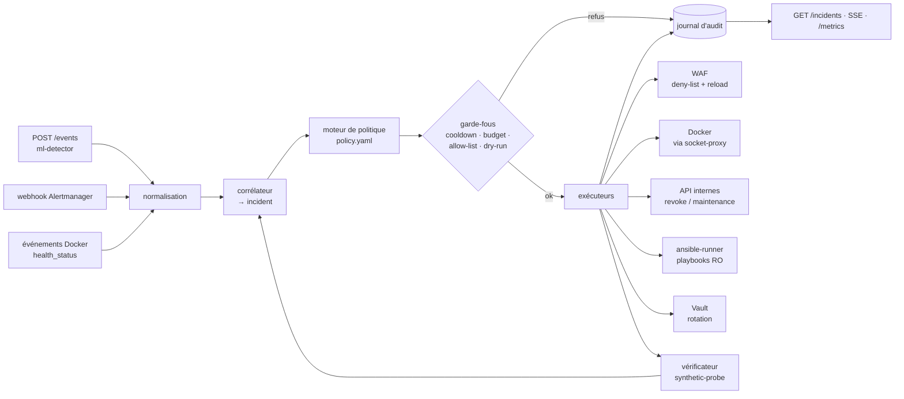

# 06 — Remédiation autonome

C'est l'axe le plus lourd des grilles : 5/20 en local, 25/70 en finale. **Toute intervention humaine pendant la démo = 0/5.**

## 1. Responsabilités du `remediation-engine`

1. **Recevoir** les événements : ml-detector (`POST /events`), Alertmanager (webhook SIEM), healthchecks Docker (via l'API d'événements filtrée).
2. **Corréler** : regrouper les événements d'une même cause dans un seul incident (même type, fenêtre de 60 s).
3. **Décider** : choisir un playbook selon une **politique déclarative** (YAML versionné).
4. **Agir** : exécuter les actions avec le minimum de privilèges.
5. **Vérifier** : attendre une transaction témoin réussie (`synthetic-probe`).
6. **Escalader** : si la vérification échoue, passer au playbook de niveau supérieur ; si le budget est épuisé, passer en `ESCALATED`.
7. **Tracer** : journal d'audit immuable, horodaté, de chaque décision et action.

## 2. Architecture interne



## 3. Politique déclarative

> La politique **réellement utilisée** est [services/remediation-engine/policy.yaml](../services/remediation-engine/policy.yaml). L'extrait ci-dessous est la version de conception ; voir [10-implementation.md](10-implementation.md) pour les écarts.

`services/remediation-engine/policy.yaml` (conception initiale) :

```yaml
defaults:
  min_anomaly_score: 0.7
  min_confidence: 0.6
  verify_timeout_s: 60
  max_actions_per_incident: 3
  global_budget: { actions: 10, per_seconds: 300 }   # au-delà → ESCALATED (anti-boucle)

protected:
  ips: ["192.168.137.1", "172.20.0.0/16"]            # hôte + réseau Docker (dont la sonde)
  containers: ["remediation-engine", "vault", "prometheus"]

playbooks:
  brute_force:
    steps:
      - block_source: { ttl_s: 900 }
      - revoke_sessions: { scope: targeted_accounts }
    escalate_to: rate_limit_strict

  injection:
    steps:
      - block_source: { ttl_s: 3600 }
      - waf_paranoia: { level: 2, ttl_s: 1800 }
    escalate_to: data_tampering

  http_flood:
    steps:
      - block_source: { ttl_s: 600 }
      - rate_limit_strict: { ttl_s: 600 }
    escalate_to: scale_out

  service_crash:
    steps:
      - restart_container: { target: "{{ event.container }}" }
    escalate_to: redeploy_service

  resource_exhaustion:
    steps:
      - restart_container: { target: "{{ event.container }}" }
      - rate_limit_strict: { ttl_s: 300 }

  db_outage:
    steps:
      - restart_container: { target: postgres }
    escalate_to: restore_db

  data_tampering:
    steps:
      - maintenance_mode: { on: true }        # lecture seule pendant la restauration
      - block_source: { ttl_s: 3600 }
      - ansible: { playbook: remediation/restore_db.yml }
      - rotate_secrets: {}
      - maintenance_mode: { on: false }
```

Avantages : la politique est **lisible par le jury**, relue en revue de code, et chaque scénario EBIOS y trouve son traitement.

## 4. Catalogue d'actions

| Action | Mise en œuvre | Réversible | Durée typique |
|--------|---------------|-----------|---------------|
| `block_source` | Écrit `deny.conf` (volume partagé avec le WAF) puis `nginx -s reload` via exec autorisé ; TTL géré par le moteur | oui (TTL) | < 1 s |
| `rate_limit_strict` | Bascule une `map` Nginx vers une zone de limitation plus stricte | oui (TTL) | < 1 s |
| `waf_paranoia` | Change le niveau de paranoïa CRS puis reload | oui (TTL) | < 1 s |
| `revoke_sessions` | `POST auth-service/internal/revoke` | — | < 1 s |
| `maintenance_mode` | `POST payment-service/internal/maintenance` | oui | < 1 s |
| `restart_container` | `POST /containers/{id}/restart` via socket-proxy | — | 3-10 s |
| `redeploy_service` | Playbook Ansible : recrée le conteneur depuis l'image de référence | — | 10-20 s |
| `restore_db` | Playbook Ansible : restauration du dernier dump `latest_good` | — | 15-40 s |
| `rotate_secrets` | Playbook Ansible : révoque les baux Vault, nouvelle clé JWT, restart auth/payment | — | 10-20 s |
| `scale_out` | `docker compose up --scale payment-service=2` (via Ansible) | oui | 10 s |

Chaque action est **idempotente** : la rejouer ne casse rien.

## 5. Maîtrise des accès du moteur

Le moteur peut redémarrer des conteneurs et restaurer la base : c'est le composant le plus dangereux. Critère explicite de la grille (axe 2).

| Mesure | Détail |
|--------|--------|
| **Pas d'accès direct au socket Docker** | Passage par `wollomatic/socket-proxy`, qui n'autorise que `GET /containers/json` et `POST /containers/<id>/(restart\|kill)`, et seulement depuis le conteneur `remediation-engine`. Pas d'`exec` : le WAF est rechargé par un simple SIGHUP |
| **Liste blanche de cibles** | Le moteur refuse toute action sur un conteneur sans label `resilience.remediable=true` |
| **Liste de protection** | IP de l'hôte, réseau Docker, sonde et conteneurs critiques ne peuvent jamais être ciblés (`protected` dans la politique) |
| **Actions figées** | Le moteur ne peut appeler que les actions codées dans `actions.py` ; la politique est intégrée à l'image (lecture seule) |
| **Jeton de service** | Les routes `/internal/*` des services exigent un jeton dédié (Docker secret `internal_token`, comparé en temps constant) et ne sont joignables que depuis le réseau `control`. Émission par Vault avec TTL court : évolution prévue (ADR-006) |
| **Aucun secret applicatif** | Le moteur ne détient que le jeton de service interne : ni mot de passe de base, ni clé JWT |
| **Budget et escalade** | Budget global de 15 actions par 5 min (`global_budget` dans `policy.yaml`), au plus 2 playbooks de repli enchaînés (`max_escalations`) ; au-delà → `ESCALATED`. Protège contre une boucle de remédiation ou un attaquant qui chercherait à faire « s'auto-saboter » le système |
| **Conteneur durci** | non-root, `read_only`, `cap_drop: ALL`, aucun port publié |
| **Audit** | Chaque action : qui l'a déclenchée (événement source), quoi, quand, résultat ; exporté vers Loki |
| **Mode `dry-run`** | Variable d'env. pour tester la politique sans agir (utile en recette) |

## 6. Vérification : la preuve de reprise

Un incident n'est `RESOLVED` **que** si :
1. `synthetic-probe` renvoie `ok: true` avec un `transaction_id` **postérieur** à la fin des actions ;
2. le score d'anomalie est redescendu sous le seuil pendant 2 fenêtres ;
3. tous les conteneurs `resilience.remediable` sont `healthy`.

Le `transaction_id` témoin et le **RTO mesuré** (début de la fenêtre anormale → transaction OK) sont affichés en grand sur le dashboard : c'est la preuve demandée par le sujet (« une nouvelle transaction réussit après l'incident »).

## 7. API du moteur

| Méthode | Route | Usage |
|---------|-------|-------|
| POST | `/events` | Entrée ML (jeton de service) |
| POST | `/alertmanager` | Entrée SIEM |
| GET | `/incidents` · `/incidents/{id}` | Dashboard, RAG |
| GET | `/incidents/stream` | SSE temps réel pour le dashboard |
| GET | `/actions` | Journal d'audit |
| GET | `/metrics` | `remediation_actions_total`, `incident_rto_seconds`, `incidents_open` |
| GET | `/health` | Sonde |

## 8. Que se passe-t-il si… ?

| Situation | Comportement |
|-----------|-------------|
| Le moteur lui-même plante | `restart: unless-stopped` ; état persisté (SQLite sur volume) → reprise des incidents ouverts |
| Le ml-detector plante | Docker le redémarre ; les règles SIEM continuent d'alimenter le moteur |
| Faux positif ML | Seuils + anti-rebond ; actions réversibles avec TTL ; la sonde n'est jamais bloquée |
| Deux incidents simultanés | Traités indépendamment, sous le budget global |
| L'action échoue | Playbook `escalate_to`, puis `ESCALATED` (notification) |
